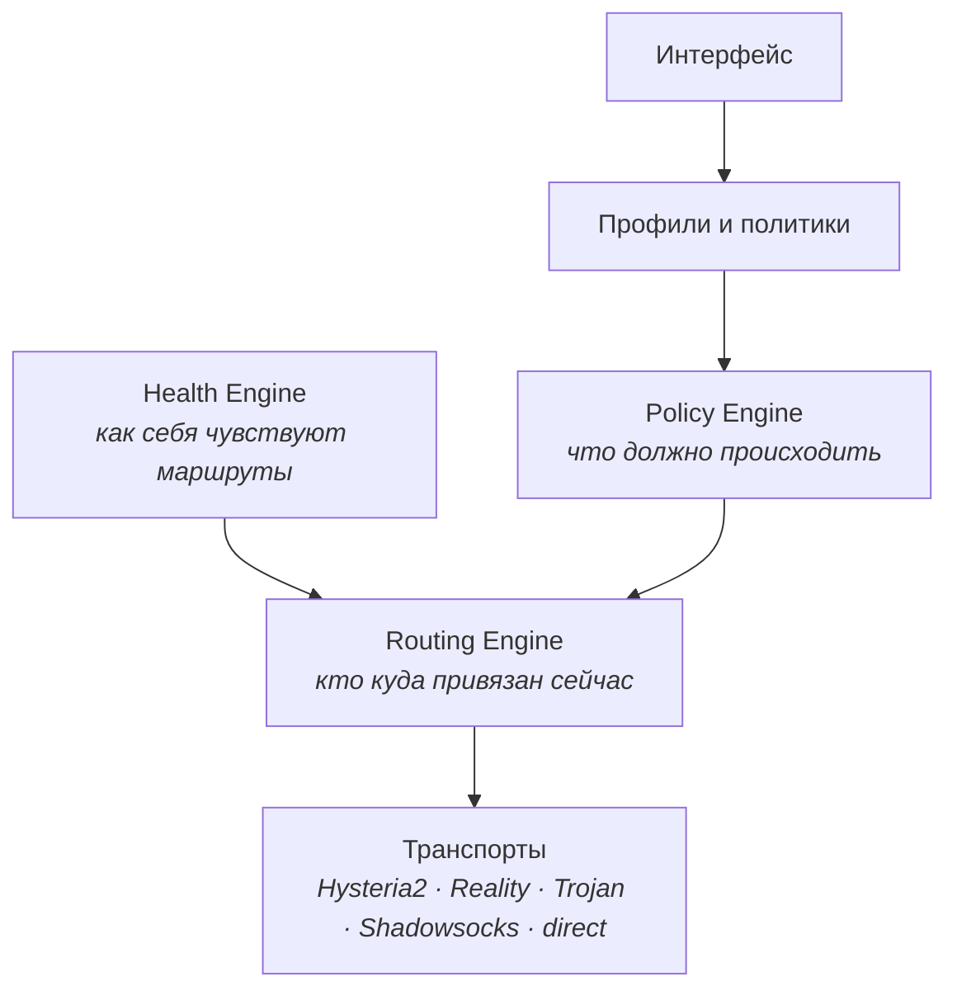

<div align="center">

# Method

**VPN-клиент, который сам решает, каким путём вести трафик.**

[](LICENSE)
[](#состояние)
[](#состояние)

**Русский** · [English](README.en.md)

</div>

---

## Что это

Клиент для **ваших собственных** серверов. Никаких встроенных подписок и чужих
узлов: вставляете свои ссылки или адрес подписки — и работает.

Поддерживаются **Hysteria2**, **VLESS + Reality** (Vision и gRPC), **Trojan**
и **Shadowsocks-2022**.

Таких клиентов много. Отличие Method в одном: он не подключается к серверу —
он **поддерживает состояние сети**.

## Почему не «ещё один клиент»

Все существующие клиенты предлагают выбрать **сервер** и ранжируют серверы по
задержке. И то, и другое неверно. Вот замер с наших собственных узлов — восемь
кругов по 20 запросов через туннель, отказов ноль:

| Узел | Транспорт | Медиана | p95 | Джиттер |
|---|---|---:|---:|---:|
| Финляндия | Reality gRPC | **65 мс** | 135 мс | 19 мс |
| Финляндия | Reality Vision | **209 мс** | 652 мс | 125 мс |
| США | Hysteria2 | 143 мс | 150 мс | 3 мс |
| США | Reality gRPC | 143 мс | 150 мс | **1 мс** |
| США | Reality Vision | 415 мс | 906 мс | 61 мс |
| США | Trojan | 417 мс | 944 мс | 32 мс |

Посмотрите на две первые строки. Это **один и тот же сервер**: та же машина,
тот же канал, та же минута. Разница только в транспорте — и она втрое по
задержке, впятеро по хвосту и вшестеро по джиттеру.

Значит выбор «подключиться к Финляндии» не означает почти ничего. Единица
выбора — не узел, а **маршрут**: узел вместе с транспортом. Клиент, который
даёт выбрать страну и подбирает протокол как придётся, выбирает вслепую.

Одного числа тоже не хватает. У двух маршрутов США медианы совпадают до
единицы — 143 и 143, — и по задержке они неразличимы. Чтобы отличить хороший
маршрут от посредственного, нужны джиттер, хвост распределения и время
рукопожатия: у Trojan оно почти вдвое больше, чем у остальных, и для браузера,
открывающего десятки коротких соединений, это важнее рабочей задержки.

Method считает **семь метрик** — задержку, джиттер, потери, время рукопожатия,
доступность, полосу и стабильность во времени — и взвешивает их **по типу
нагрузки**. Игре важны джиттер и потери, загрузке — полоса, браузеру — быстрое
рукопожатие. Это разные ответы, и одного «лучшего сервера» не существует.

> Замеры сняты с канала дата-центра. На домашнем Wi-Fi и в сотовой сети
> абсолютные значения будут хуже, а расслоение между маршрутами — заметнее.

## Маршруты не взаимозаменяемы

Второе отличие важнее первого. Все известные клиенты считают выходы
равноценными и ранжируют их одним числом. Но протоколы стоят на **разных
способах пройти**, и протоколы на одном способе умирают вместе:

| Способ пройти | Чем закрыт | Чем убивается |
|---|---|---|
| QUIC поверх UDP | Hysteria2, TUIC | фильтрацией QUIC |
| HTTP/2 в поддельном TLS | Reality gRPC | распознаванием подделки Reality |
| Голый TCP в поддельном TLS | Reality Vision | тем же самым |
| Настоящий TLS | Trojan | только блокировкой домена или IP |
| Шифрованный поток без рукопожатия | Shadowsocks-2022 | ничем из перечисленного |

Сеть может пропускать UDP и при этом резать QUIC — проверено. В такой сети
переключение с Hysteria2 на TUIC не даёт **ничего**: оба лежат на одном
способе. Method знает об этом и при отказе уходит на другой способ, а не на
соседний протокол.

## Как это устроено



Конфигурация ядра описывает не серверы, а **полосы** — «игры», «стриминг»,
«браузер», «загрузки», «чувствительное», «напрямую». Правила «приложение,
домен или порт → полоса» компилируются один раз. А привязка «полоса → узел»
меняется на лету, **не разрывая туннель и не обрывая соединения**.

Именно поэтому переключение при деградации незаметно: это не переподключение,
а смена привязки.

## Состояние

| Платформа | Клиент | Оркестратор |
|---|---|---|
| macOS | выпущен 1.0.0 | работает |
| Android | выпущен 1.0.0 | работает |
| Windows 10/11 | отдельная сборка | нет |
| iOS | планируется | — |

Разбор ссылок, сборка конфигурации ядра, полосы и движок выбора маршрута
живут в общем слое на Rust (`core/`) и одинаковы на всех платформах.
Платформенного здесь — только интерфейс и связки с системой: на macOS
привилегированный демон, на Android `VpnService`.

Оркестратор на Android проверен на живом устройстве: первое решение через
две минуты после подключения, переключение способа обхода на работающем ядре
без разрыва соединений, выживание при смене Wi-Fi и сотовой сети.

## Сборка

Подробно — в [BUILDING.md](BUILDING.md).

Для сборки понадобится ядро [sing-box](https://github.com/SagerNet/sing-box):
на macOS — исполняемый файл, на Android — `libbox.aar` из того же проекта.
Оно **не входит** в этот репозиторий и загружается отдельно (см. раздел о
лицензии).

## Авторские права

Copyright (C) 2026 Ковалев Георгий (Kovalyov Georgiy) — см. [COPYRIGHT](COPYRIGHT).

## Лицензия

Код Method распространяется на условиях **GNU GPL версии 3 или более поздней** —
см. [LICENSE](LICENSE).

Method использует ядро [sing-box](https://github.com/SagerNet/sing-box),
запуская его **отдельным процессом** и общаясь с ним по локальному HTTP.
Ядро не входит в этот репозиторий и загружается при первой сборке или запуске.
sing-box распространяется на своих условиях; его авторы к этому проекту
отношения не имеют, и проект никак с ними не аффилирован.

## На чьих плечах

Идея политик поведения сети и групп маршрутов не нова: её в разных видах
реализовали [Mihomo](https://github.com/MetaCubeX/mihomo), Surge и
[Psiphon](https://github.com/Psiphon-Labs/psiphon-tunnel-core). Method
заимствует у них честно и говорит об этом прямо. Новое здесь — выбор маршрута
по способу обхода, а не по задержке узла.

## P.S.

```text
                                        ........
                            .:;=*CwZa$KK&&gDO&HOHKKmoJvr,.
                       '+CU80000MM@WR#OKbaXhhhkhmm&RW0000WKn~.
                    ;CO0N00M@@8DOKahCCT*s*ccvvvc=zvvThmD@0NNNQo:
                 -sO0N0MW@@RUwz;:,'::~;=zzr;r+==cc==+r;~<CXUWNNNK<.
               ra@N0WQR#mCz:.    ....'-,-:~~::,,~:~r~:'    .~zXHMN@z
             ~K000Qmae+:-...'--.-'''..'.''--'--,:''-.....     .,rCDNO:
            CNNBWksvc:,~:~;r;~,',:,,''---,,'',-.   ...''''.. .'.'':oW@*.
           CN0M8r-vr,rv=r;;;~:,,,,,'-,,,,,,,'.'...   ...'.'--,:::~,;CRQh;
          ~0M@8s.;:.~=zz+::;;;~-..-''',:,,~:'........''....-,::::::,;ZQUUJ
          aNM8a'-:-~<cssr,,~r;'.   .......-,'...  ........'-:~:,-,;r'~aRwaJ
         .00RUr.:-:+x*sT<~:~;~,... .   . ..         ....'-'-::~:::=>' rahhK*
         JN#a=.-,:rvusT*c=r~;~;:--..  ........... . ....'~:::~::,-<=;:~sn=hKr
         mNRo:''-rcsJxsz==+~:.',:,-'.........'..... .....-,:~~::::>*vr:;=;=Ka
         gNOhr,;=zCTJTJY=c=r~'..,:,,.......-...''.'''.....'-'-,~:-=Tcr;-:r;XQ;
      :-=N0Dhz*uJ*Jwss*Jsc<<r~-..,''...'..'. ....  .......''-,':~r*z+;r<ccrv&h
     <0aoaQ&moscvzzCz==zz;r-.-,..                  ..........-,-:==>-:+;x=cuhX~
     :N0ZCa&KhTsz*xuC=<<-,,  .'.   .  ....         .. ..         ~=r+zv<vCCxCa$h.
      RWJoZmmwC*z**vuJ*+>sJemRRKdUOKZkoCnr:~r=r~:;r;rcv==c=sJT*=-.-~=**zJZbCoKMN:
      h8C*abkaCYzvCvvob##g$mmehmgW000W#8WmhCT*zzCa$U#M00NNN@KmU#OmY=cx=cJUOa*wNa
      -aU&00XaCJC*JTcvTZUUaoXamaZZmUD##DWWaz~--+Z@0@@WQKaoJoZC==CH8mT+r=zmR$nX8-
       coOKC*aZJ*s*=:..:vCZwCoKDRDhZhmhaDWDv. .CWWKmHHQ00WOmgM0RKKaT=<==Ym@RmK:
       ~oCzccemaC*Tz;,.....    ...':r=;;xZUc   eQoc**zz<+r~,--;;;,  .~cJkamhh<
        saTCeoamXCunT=~'':~~:~;+=<r;:,:~~=v,   vZu=~,:::,::-.'-,,..'.~semn=*n
         JZwXeaUdZJ=r;:..  .'..',-'..  .;<;.   '~C=. .:;;~~;~;~,'';~~rCba=xa-
         ;C*XmaKKhsc+==<;-..         .'~vz;.   -:oJ,          ..-~;,:=CmUme'
          =h#badUZCv<<==r;,-'..'...'~*aZu=:..  '~=eo;...    ..-~r<=cYCemCs.
            ;UmmKXCTszc=>=r;r;,'-,roOK=~=vr.   .-,z*Zac;::~~;;~r+r*noh$Qo=
             $UmdKmZZwoCTJz<+r;<vhKmUUnr:;:    .....rHdC*=<<===c==zTwK@J-
             a&dmbg#DHUahooCszswaC<+*wK@@OZuJTczod#W&hhZeCCuTTnCChm&80Q
             CRUUaoa&RRK$mahhoCn+'..,~;=CKWM00B@WWKCvv+=CoooweZmK#8WQ8k
             ,8UKbonToKUZoweewnv=<r:-'-:;voKD&ZT+:.-,~~~cCoZmUHH&OKamQ+
              YMKKaCz>saaszxCwabHQQDUXCuJTCzvz*z+~r+=uCkCowaKmhZawoa#g.
               CWKUoJ=rJZC=r*ZUZCnoam$mUaXZhha&OD#8W@@@@WRKZscnXCsoO@r
            ,o' s0R$hC==ChJsC*r~:-:~~r~:::;ccr+=vsCCJzcs*z*<+JZo*h8Q+
           JNk   ;R0#ao*CeC*c=r++rvCooXmKDRQ#HUaooJxc+==r<c*oahoKQo.
         ,UNN;     x808UaaZCJz=rr~:;>rr;~,,,':;r+>r~:~;:rzomUmUDw-
       ~aNNNN#      .cON0Q88RKZscr~-,.    '-.  ....,;~;vo&R#ROc.
   .~n#NNNNNNNX        ;m00W888RKmooC*c<;~;+=;:;+rcCnwKQWQW@Jxa='
,zmMNNN000NNNNNo         :o#WWR##R#DO&KKmaXZXamUHOOgR88R#WK~ 'NNN$='
NNNN00000000NNNNC          .=mQ8R&UUKOgD##DQ8WWW8QOKUKg8Qn.   QNNNNN8msr:.
0000000000000NNNNa            -zZ&#HKmmmmmmmKKKK&KmmKR#o,     oNNN0NNNNNNN0QKaeJz=;~-..
000000000000000NNNH              .;skmUKUmKUaa$bmK&UX='       ~NNNN000000NNNNNNNNNNNNN0WR&
0000000000000000N0ND.                .'~>=coQ@8Q#ar.           WNNN00000000000000000NNNNNN
00000000000000000NNNR.                    ~mNNNNN#C=,          =NNN00000000000000000000000
000000000000000000NNNR.                 vRNN000000NNNQY.        ONNN0000000000000000000000
0000000000000000000NNN#.              =QNN0@WWW88##WNNNWr       ,NNNN000000000000000000000
00000000000000000000NNNR.          .sWNNNN00@W8QRQgR0NNB0m:      oNNN000000000000000000000
000000000000000000000NNNO.        ,>JhJwmR0000MW88RR0NXCaR0w.    .0NNN00000000000000000000
```

<p align="center"><b>РКН, не блокируйте!</b></p>
